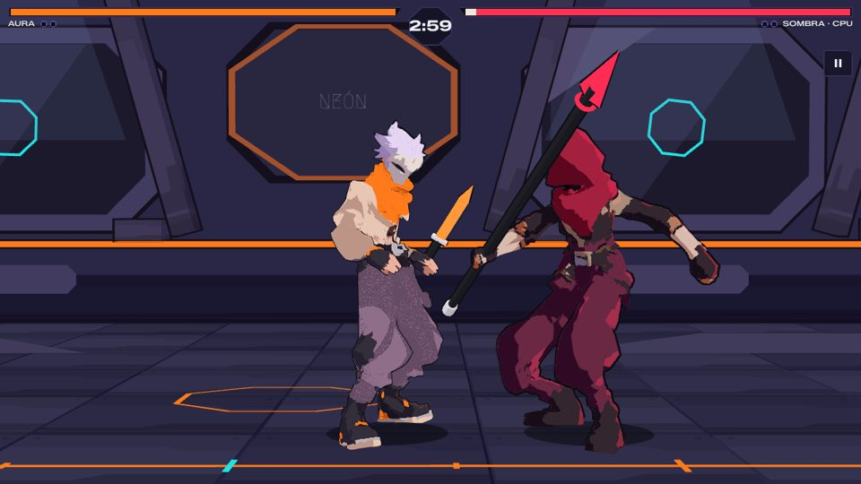
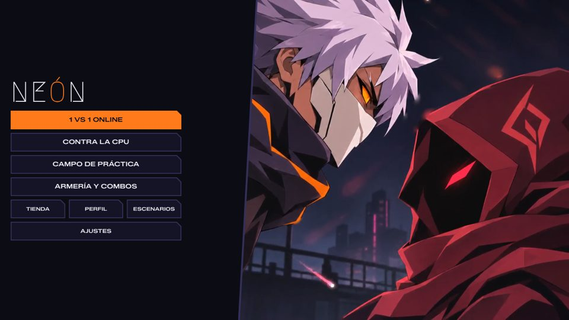
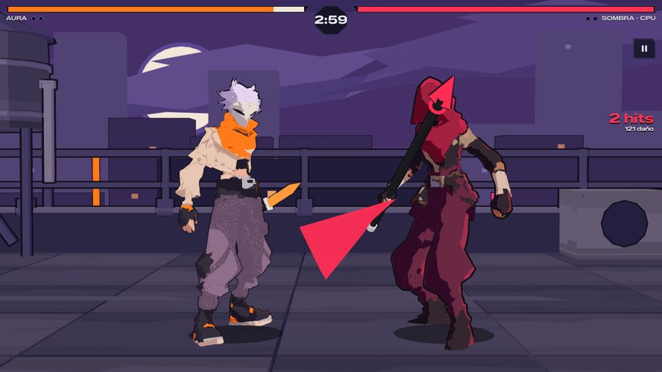
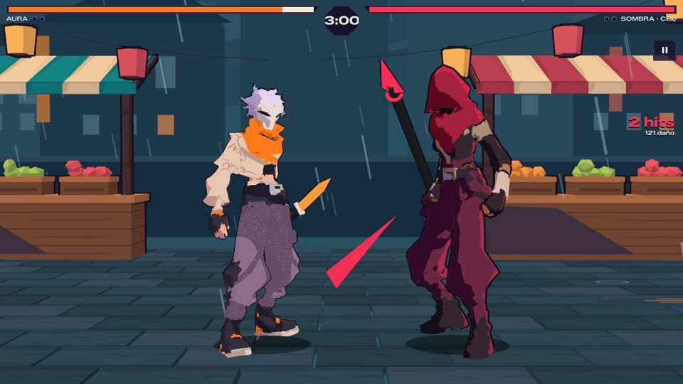
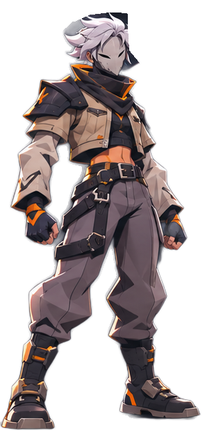
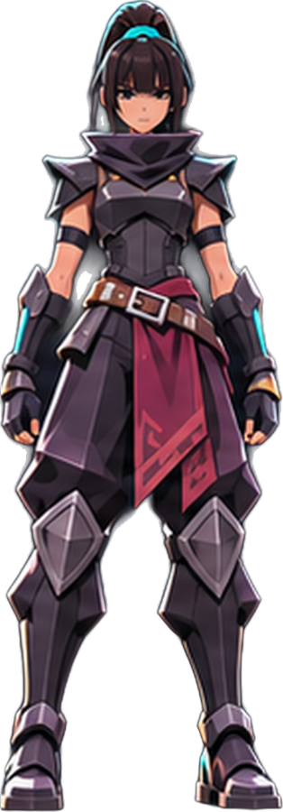
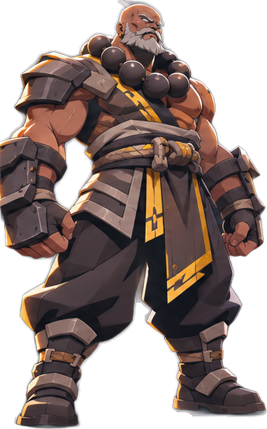
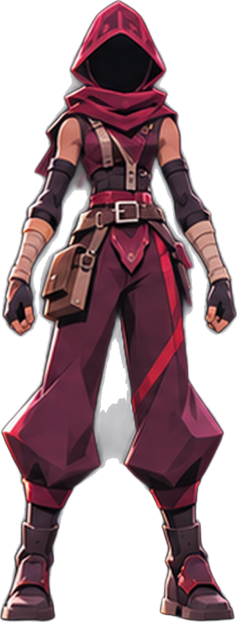

# NEÓN

**Juego de lucha 2.5D para móvil** con estilo cel-shading de anime, combates 1 contra 1 con armas y online entre dos móviles. Funciona en el navegador y se puede instalar como app en iPhone y Android.

### ▶ Jugar: **[peleasdemo.web.app](https://peleasdemo.web.app)**

La web se actualiza sola cada vez que se fusiona un cambio en `main`.



## Qué es

NEÓN es un prototipo de juego de lucha pensado desde el principio para pantallas táctiles: se juega con **swipes**, sin botones de dirección. Se inspira en los clásicos del género (Street Fighter, Skullgirls, Marvel Tōkon) en profundidad, y en los fondos de anime en 3D tipo Dragon Ball FighterZ en lo visual.

- **Combate**: golpes con gestos (toque y swipes en cuatro direcciones), combos en cadena, juggles, agarre con escape, guardia alta y baja, dash, salto lateral, doble salto y supersalto.
- **Personajes**: cada uno elige un arma (daga, espada, martillo o lanza) que cambia sus ataques y sus combos.
- **Modos**: online 1 contra 1 entre dos móviles, contra la CPU con 4 dificultades, campo de práctica con cajas de golpe visibles y armería con los combos de cada arma.
- **Escenarios**: Sala de pruebas, Azotea y Mercado bajo la lluvia, en cel-shading con contorno de tinta.
- **Online determinista**: la simulación corre a 60 fotogramas por segundo y es idéntica en los dos móviles. Solo viajan las entradas de cada jugador.

<table>
  <tr>
    <td></td>
    <td></td>
    <td></td>
  </tr>
  <tr>
    <td align="center">Menú principal</td>
    <td align="center">Azotea</td>
    <td align="center">Mercado bajo la lluvia</td>
  </tr>
</table>

## Personajes

<table>
  <tr>
    <td align="center"></td>
    <td align="center"></td>
    <td align="center"></td>
    <td align="center"></td>
  </tr>
  <tr>
    <td align="center"><b>AURA</b><br>La Centella · daga<br>Rápida, con doble salto</td>
    <td align="center"><b>VEGA</b><br>Filo de Neón · espada<br>Combos largos</td>
    <td align="center"><b>KAI</b><br>El Bastión · martillo<br>Lento, con armadura</td>
    <td align="center"><b>SOMBRA</b><br>La Lanza Roja · lanza<br>Alcance y derribos bajos</td>
  </tr>
</table>

Aura y Sombra ya tienen su modelo 3D propio. Vega y Kai usan todavía modelos de base mientras se terminan los suyos.

## Cómo se juega

**Móvil** (en horizontal):

| Mitad izquierda: moverse | Mitad derecha: atacar |
|---|---|
| Swipe y soltar: paso corto | Toque: ataque rápido |
| Dos swipes seguidos: dash | Swipe →, ←, ↑, ↓: ataques distintos según la dirección |
| Swipe y mantener: caminar | Botón **Bloqueo**: cubrirse |
| Swipe ↑: saltar · ↗ o ↖: salto lateral | Botón **Agarre**: agarrar al rival |
| Swipe ↓ y mantener: agacharse | |

**Ordenador**: A/D andar · W saltar (W+A o W+D, salto lateral) · S agacharse · J ataque rápido · flechas = swipes de ataque · K agarre · L bloqueo.

**Instalarlo como app**: Ajustes → **Añadir NEÓN a inicio**. Explica los pasos en iPhone (Safari) y en Android (Chrome y Samsung Internet).

## Tecnología

- **Three.js** con un shader cel-shading propio: tres tonos de luz, contorno de tinta y líneas de cómic entre zonas de color.
- **Simulación determinista** a 60 fotogramas por segundo en JavaScript puro, sin aleatoriedad (`public/js/sim.js`).
- **Online P2P** con PeerJS/WebRTC: lockstep con retardo de entrada y resincronización (`public/js/net.js`).
- **Personajes 3D**: el modelo se genera desde el concept con TRELLIS y se limpia, colorea por zonas, riggea y alisa por partes en **Blender** con scripts de Python (`tools/`).
- **Despliegue** en Firebase Hosting con GitHub Actions: al fusionar en `main` se pasan los tests y se publica.

## Desarrollo

```bash
# servidor local
python3 -m http.server 8080 -d public     # → http://localhost:8080

# tests
node test/combos.mjs && node test/moves.mjs && node test/online.mjs && node test/ui-shell.mjs \
  && node test/dash.mjs && node test/swipe-hold.mjs && node test/cpu.mjs
```

- **Flujo de trabajo**: cada cambio va en una rama y llega a `main` mediante Pull Request. El responsable revisa y fusiona.
- **Probar el online sin dos móviles**: abre dos pestañas con `#mocknet` al final de la URL.
- **Parámetros de prueba en la URL**:
  - `?stage=sala|azotea|mercado`: elegir escenario.
  - `?auraoriginal`: Aura con el diseño anterior.
  - `?clasico`: modelos antiguos.

## Documentación

| Documento | Contenido |
|---|---|
| [LEEME.md](LEEME.md) | Estructura del código y regeneración de modelos y animaciones |
| [character-documentation/](character-documentation/README.md) | Fichas de personajes, roster y registro de cambios ([CHANGELOG](character-documentation/CHANGELOG.md)) |
| [NEON_ART_STYLE.md](character-documentation/NEON_ART_STYLE.md) | Guía del estilo gráfico: cel-shading, tinta, paleta y escenarios |
| [AURA_PARTES_A_MANO.md](character-documentation/AURA_PARTES_A_MANO.md) | Cómo corregir a mano en Blender las partes de un personaje |
| [docs/CPU.md](docs/CPU.md) | Cómo piensa la CPU y sus 4 dificultades |
| [docs/DEPLOY.md](docs/DEPLOY.md) | Despliegue automático y cómo volver atrás |

## Créditos

Modelos de base y animaciones de [Quaternius](https://quaternius.com) (CC0). Fuentes Megrim y Zalando Sans Expanded (OFL). Detalle en [CREDITOS.md](CREDITOS.md).
