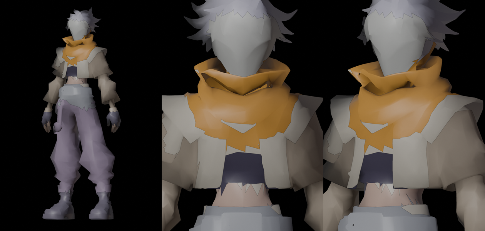

# Aura: corregir las partes a mano en Blender

Aura está dividida en 12 partes (pelo, máscara, bufanda, chaqueta, mangas, guantes, top, cinturón, pantalón, botas, piel de brazos y piel del torso). Cada parte tiene **un color propio, su propio alisado y su propia sombra** en el juego. El script decide las partes de forma automática, pero en zonas donde el escaneo mezcla capas (por ejemplo, el borde de la bufanda) es más rápido y exacto **elegir las caras a mano**.

Aquí solo **cambias a qué parte pertenece cada trozo**. No hay que modelar nada.



*Ejemplo de lo que hay que corregir: el triángulo marfil dentro de la bufanda naranja y los picos naranjas que bajan sobre la chaqueta.*

---

## 0. Preparar (una vez)

En Git Bash, dentro de la carpeta del proyecto:

```bash
git fetch
git switch main
git pull
```

Abre **`art/aura/aura_partes.blend`** con doble clic. Hace falta Blender 5.3 o superior.

Cada parte se ve de un color: la bufanda en naranja, la chaqueta en marfil, el pantalón en lila… Si todo se ve gris, arriba a la derecha del visor 3D abre la flecha **⌄ junto a las bolas de sombreado** y en **Color** elige **Objeto**.

## 1. Moverte por la vista

| Para… | Haz… |
|---|---|
| Girar | Mantén pulsada la **rueda del ratón** y arrastra |
| Desplazar | **Mayús + rueda** y arrastra |
| Acercar | Gira la **rueda** |
| Ver de frente / de lado | **1** / **3** del teclado numérico (o el **gizmo** de ejes, arriba a la derecha) |
| Encuadrar lo seleccionado | **.** del teclado numérico (o menú **Vista → Encuadrar seleccionado**) |
| Deshacer | **Ctrl + Z** |

## 2. Quitar caras que sobran de una parte (ej.: naranja sobre la chaqueta)

1. Haz clic en la **bufanda** (o en `Aura_bufanda` en la lista de objetos de arriba a la derecha, el *Esquematizador*).
2. Pulsa **Tab** para entrar en *modo edición*.
3. Pulsa **3** (encima de las letras) para seleccionar **caras**.
4. **Alt + A** para no tener nada seleccionado.
5. Pulsa **C**: aparece un círculo. **Pinta con clic izquierdo** sobre las caras naranjas que sobran. La rueda cambia el tamaño del círculo. Termina con **clic derecho** o **Esc**.
   - Si te equivocas, pinta con **clic central** para quitar caras de la selección.
   - **Alt + Z** activa la *transparencia* para seleccionar también caras que quedan detrás.
6. Pulsa **P → Selección**. Las caras pasan a un objeto nuevo llamado `Aura_bufanda.001`.
7. Pulsa **Tab** para salir del modo edición.
8. En el *Esquematizador*, haz clic en `Aura_bufanda.001` y después **Ctrl + clic** en la parte que debe recibirlas, por ejemplo `Aura_chaqueta`. **La última que pulses es la que se queda.**
9. Con el ratón sobre el visor, pulsa **Ctrl + J**. Las caras ahora son chaqueta y se ven de su color.

## 3. Añadir caras que faltan a una parte (ej.: el triángulo marfil dentro de la bufanda)

Es lo mismo, al revés:

1. Selecciona la **chaqueta** y entra con **Tab**, luego **3** y **Alt + A**.
2. Con **C**, pinta las caras marfil que deberían ser bufanda.
3. **P → Selección**, **Tab**.
4. En el *Esquematizador*: `Aura_chaqueta.001` y luego **Ctrl + clic** en `Aura_bufanda`.
5. **Ctrl + J**.

## 4. Guardar y enviar

1. **Ctrl + S** para guardar.
2. En Git Bash:

```bash
git switch -c fix/aura-partes-a-mano
git add art/aura/aura_partes.blend
git commit -m "Aura: partes corregidas a mano"
git push -u origin fix/aura-partes-a-mano
```

3. Avisa a Claude. El script `tools/bl_aura_review.py` usará tus partes tal cual: las alisará, les pondrá color y sombra, exportará `aura_review.glb` y abrirá el PR.

## Reglas para no romper nada

- **No muevas, rotes ni escales** objetos ni caras (G, R, S). Si pasa por accidente: **Ctrl + Z**.
- **No borres caras** (X o Supr). Solo pásalas de una parte a otra.
- Los nombres de las partes deben **seguir empezando por `Aura_`**: `Aura_bufanda`, `Aura_chaqueta`… Al unir con **Ctrl + J** se queda el nombre de la que pulsaste la última, que es justo lo que quieres.
- No toques `Armature` (el esqueleto).

## Cómo encaja en el proceso

```
aura.glb (combate)
   └─ tools/bl_aura_review.py ── genera las partes de forma automática ──► art/aura/aura_partes.blend
                                                                            │  (correcciones a mano, esta guía)
   └─ tools/bl_aura_review.py ── alisado, color y sombra por parte ◄────────┘
         └─► public/assets/chars/aura_review.glb ──► juego (Ajustes → Aura 3D y combate)
```

- Para regenerar las partes automáticas, **se pierden los cambios a mano**:
  `python3 -c "import runpy,sys; sys.argv=['x','6','0.5','art/aura/aura_partes.blend']; runpy.run_path('tools/bl_aura_review.py')"`
- Para exportar el modelo del juego desde el `.blend`:
  `python3 -c "import runpy,sys; sys.argv=['x','6','0.5','public/assets/chars/aura_review.glb']; runpy.run_path('tools/bl_aura_review.py')"`
  Si `art/aura/aura_partes.blend` existe, el script lo usa. Con `--auto` lo ignora.
