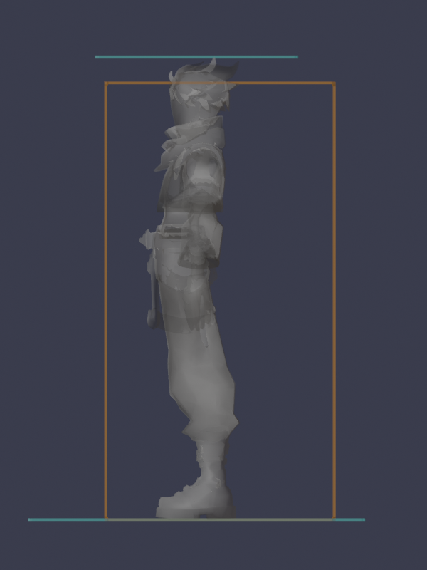

# Archivos de Blender: dónde están y cómo trabajarlos

Guía para el diseñador 3D de NEÓN. Para el flujo de Git (fork, ramas, Pull Requests) lee también [CONTRIBUTING.md](../../CONTRIBUTING.md).

**Versión de Blender: 5.3 o superior.** Los archivos están guardados con la 5.3 y una versión anterior puede no abrirlos.

## 0. Paso inicial: el esqueleto común (misma hitbox para todos)

**Todo personaje empieza en `art/comun/esqueleto_neon.blend`**, sea nuevo o una revisión. Ese archivo contiene el esqueleto de NEÓN (24 huesos: `Root`, `Hips`, `Torso`, `Neck`, `Head`, `UpperArm.L`…) y tres guías que no se exportan:

| Guía | Qué es |
|---|---|
| `REF_suelo` | El suelo: los pies apoyan en Z = 0 |
| `REF_altura` | Altura de referencia: 2,76 m en Blender |
| `REF_hurtbox` | La caja donde el juego recibe golpes con el personaje en reposo. **El cuerpo debe quedar dentro.** Pelo, capucha, bufanda o arma pueden salir, porque son solo visuales. El frente del personaje mira hacia −Y |



**Por qué:** el juego no calcula los golpes con la malla, sino con un esqueleto propio que tiene las mismas articulaciones (cadera, cintura, cuello, cabeza, rodillas y tobillos). Si todos los personajes usan este esqueleto:
- **Todos tienen la misma hitbox** a igual escala, y lo que ves en pantalla coincide con lo que golpea y recibe golpes.
- **Las animaciones sirven para todos**, porque se pasan de un personaje a otro por nombre de hueso.
- **El tamaño de cada personaje se decide en el juego**, no en Blender: es el valor `scale` de `public/js/data.js` (Aura 0,97, Vega 1,00, Sombra 1,03, Kai 1,12). Un personaje grande como Kai se modela con este mismo esqueleto y altura, y el juego lo agranda. Así su hitbox crece en proporción y de forma controlada.

**Cómo empezar un personaje:**
1. Abre `art/comun/esqueleto_neon.blend` y guárdalo con otro nombre: **Archivo → Guardar como** → `art/<personaje>/<personaje>_base.blend`.
2. Modela o importa el cuerpo encima del esqueleto. Respeta la altura (`REF_altura`), apoya los pies en `REF_suelo` y mantén el cuerpo dentro de `REF_hurtbox`.
3. **No muevas, renombres, borres ni añadas huesos.** Las alturas de las articulaciones son fijas. Si los brazos o las piernas no encajan con el modelo, ajusta la malla o pide al responsable que adapte codos, muñecas y rodillas con el script del esqueleto (`fit_joints` en `tools/bl_fighter_armature.py`); ese ajuste solo cambia la posición lateral, nunca la altura.
4. Une la malla al esqueleto: **Ctrl+P → Con pesos automáticos**, y después corrige los pesos en Weight Paint.
5. Borra las guías `REF_*` antes de entregar, o déjalas: el script de exportación las ignora.

Vega y Kai ya parten de este esqueleto, y Aura también. **Sombra tiene alguna articulación hasta 12 cm más alta** que el esqueleto común: conviene alinearla en su próxima revisión.

Si el esqueleto común cambia algún día, se regenera con `python -c "import runpy; runpy.run_path('tools/bl_esqueleto_comun.py')"`. Ese cambio afecta a todos los personajes y animaciones, así que **solo lo hace el responsable**.

## 1. Mapa de carpetas

```
art/
├── comun/esqueleto_neon.blend  ← PASO 0: esqueleto común y guías de tamaño (punto de partida de TODO personaje)
├── conceptart/            ← REFERENCIA: hojas de modelo de los 4 personajes (no editar)
├── aura/                  ← fuentes 3D de Aura, una por fase del pipeline
│   ├── aura_01_trellis2_raw.glb        salida de la IA (forma de referencia, no editar)
│   ├── aura_02_recolor_highpoly.blend  alta poligonal con la lámina proyectada
│   ├── aura_03_flat_highpoly.blend     alta con color plano por zonas
│   ├── aura_04_lowpoly.blend           malla de juego (30 k triángulos) + UV + textura
│   ├── aura_05_rig.blend               malla de juego con esqueleto y pesos
│   └── aura_partes.blend               las 12 partes de Aura para el alisado y color por partes
├── sombra/                ← igual que Aura (01…05) + prototipo
├── vega/vega_base.blend   ← base editable (aún sin modelo final)
└── kai/kai_base.blend     ← base editable (aún sin modelo final)

public/assets/chars/       ← MODELOS DEL JUEGO (.glb): se GENERAN desde art/, no se editan a mano
public/assets/practice/    ← hojas de sprites de Aura 2D del Campo de práctica (.webp)
character-documentation/references/<personaje>/   vistas sueltas del concept que usa el pipeline
tools/                     ← scripts de Blender (Python) que generan los .glb
```

## 2. Qué archivo abrir según la tarea

| Quiero… | Archivo | Cómo |
|---|---|---|
| Cambiar qué zona de color es cada trozo (chaqueta, bufanda, pelo…) de Aura | `art/aura/aura_partes.blend` | Pasar caras entre partes: [guía paso a paso](../../character-documentation/AURA_PARTES_A_MANO.md) |
| Repintar el color plano en alta | `art/<personaje>/<p>_03_flat_highpoly.blend` | Vertex Paint sobre el atributo `Col` (las zonas están en `LblCol`) |
| Cambiar la forma (retopo, máscara, pelo, siluetas) | `art/<personaje>/<p>_04_lowpoly.blend` | Modelado normal; luego hay que repetir el rig (fase 05) |
| Corregir pesos o deformaciones al animar | `art/<personaje>/<p>_05_rig.blend` | Weight Paint; no renombrar huesos |
| Empezar un personaje nuevo | `art/comun/esqueleto_neon.blend` | Ver el paso 0 |
| Modelar Vega o Kai | `art/vega/vega_base.blend`, `art/kai/kai_base.blend` | Ya llevan el esqueleto común ([ficha](../../character-documentation/VEGA_KAI_BASES.md)) |
| Crear animaciones | Un archivo nuevo en `art/<personaje>/anim/` | Sobre el rig de la fase 05; ver el apartado 6 |

Si no sabes qué archivo tocar, pregunta antes de empezar. Así nadie trabaja sobre el mismo archivo a la vez (apartado 5).

## 3. Reglas que el juego necesita

El juego lee los archivos de forma automática. Si se rompe una de estas reglas, el personaje sale mal o no carga:

1. **Esqueleto común** (paso 0): mismos huesos y alturas para todos. Los nombres no se cambian ni se borran. Las animaciones van por nombre (`Torso`, `Neck`, `Head`, `UpperArm.L`…).
2. **Nombres de materiales**: `Aura_ropa`, `Aura_pelo`, `Aura_mascara`, `Aura_piel` en Aura, y `Sombra_ropa`, `Sombra_piel`, `Sombra_capucha` en Sombra. El nombre decide cómo se sombrea cada material en cel-shading.
3. **Nombres de partes** en `aura_partes.blend`: siempre empiezan por `Aura_` (`Aura_bufanda`, `Aura_chaqueta`…).
4. **Color de zona**: es el atributo de color `Color` (o `Col` en la fase 03), no una textura. Cada zona es un índice; la lista está en `tools/neon_chars.py`. Por ejemplo, en Aura: 0 chaqueta, 1 pantalón, 2 gris, 3 grafito, 4 negro, 5 naranja, 6 pelo, 7 máscara, 8 piel, 9 metal.
5. **Orientación y escala**: Y hacia arriba en el GLB (Z en Blender), escala aplicada (Ctrl+A → Escala) y el personaje mirando hacia −Y en Blender.
6. **Presupuesto**: unos 30 000 triángulos por personaje como máximo, para que vaya fluido en móvil.
7. **Estilo**: colores planos de la paleta del concept, sin texturas fotográficas ni degradados. Ver la [guía de estilo](../../character-documentation/NEON_ART_STYLE.md).
8. **Licencias**: nada de modelos, texturas o animaciones de terceros sin licencia libre (CC0 o similar). Todo lo que se use se apunta en [CREDITOS.md](../../CREDITOS.md).

## 4. Del archivo de Blender al juego

No hace falta exportar a mano. En tu Pull Request incluye el `.blend` modificado y di qué cambiaste. El responsable ejecuta el script que genera el `.glb` del juego, con los nombres, ajustes y alisado correctos.

Si quieres verlo tú mismo antes, con Python 3.13 y `pip install bpy`, desde la carpeta del proyecto:

```bash
# Aura en revisión (usa art/aura/aura_partes.blend)
python -c "import runpy,sys; sys.argv=['x','6','0.5','public/assets/chars/aura_review.glb']; runpy.run_path('tools/bl_aura_review.py')"
```

Para verlo en el juego, lanza el servidor local (ver [CONTRIBUTING.md](../../CONTRIBUTING.md)) y abre:
- `http://localhost:8080/aura_preview.html`: visor de Aura, con «Modelo actual» frente a «Comparar cambios».
- `http://localhost:8080/index.html`: el juego completo, con Campo de práctica o combate contra la CPU.

## 5. Archivos binarios: uno por persona

Git no puede mezclar dos versiones de un `.blend`. Si dos personas cambian el mismo archivo a la vez, se pierde el trabajo de una de ellas. Por eso:

- **Antes de empezar**, avisa de qué archivo vas a tocar: en la pizarra de tareas o al responsable.
- **Haz cambios pequeños** y ábrelos en un PR pronto. No pases días con un `.blend` sin subir.
- **Actualiza tu copia antes de abrirlo** (ver CONTRIBUTING). Si el archivo cambió mientras trabajabas, avisa antes de subir el tuyo.
- **No subas** las copias de seguridad de Blender (`*.blend1`, `*.blend2`). El `.gitignore` ya las ignora.
- **No guardes texturas dentro del `.blend`** (Archivo → Externo → Empaquetar) salvo que se pida; los archivos crecen mucho.

## 6. Animaciones

- Se hacen sobre el rig de la fase 05 (`<p>_05_rig.blend`), una acción por movimiento, con nombre claro: `aura_especial_1`, `aura_super`…
- **A 60 fotogramas por segundo.** En un juego de lucha cada movimiento tiene tres fases: preparación, golpe activo y recuperación. Apunta en qué fotograma golpea, porque hay que hacer coincidir la caja de daño.
- **Poses exageradas y claras**, como en las poses de referencia de las hojas de modelo.
- Si vienen de Cascadeur o de captura de vídeo (Plask, DeepMotion…), entrégalas en FBX dentro de `art/<personaje>/anim/`. El responsable las adapta al esqueleto y las mete en `<p>_anims.glb`.

## 7. Dudas frecuentes

- **¿Puedo crear archivos nuevos?** Sí, dentro de `art/<personaje>/`, con nombres sin espacios ni tildes (`aura_06_pelo_v2.blend`).
- **¿Puedo borrar archivos?** No; si algo sobra, dilo en el PR.
- **El personaje sale gris o negro en el juego**: suele ser un nombre de material cambiado o el atributo `Color` borrado o renombrado.
- **Se deforma raro al animar**: revisa los pesos en la fase 05 y que no se hayan movido huesos.
